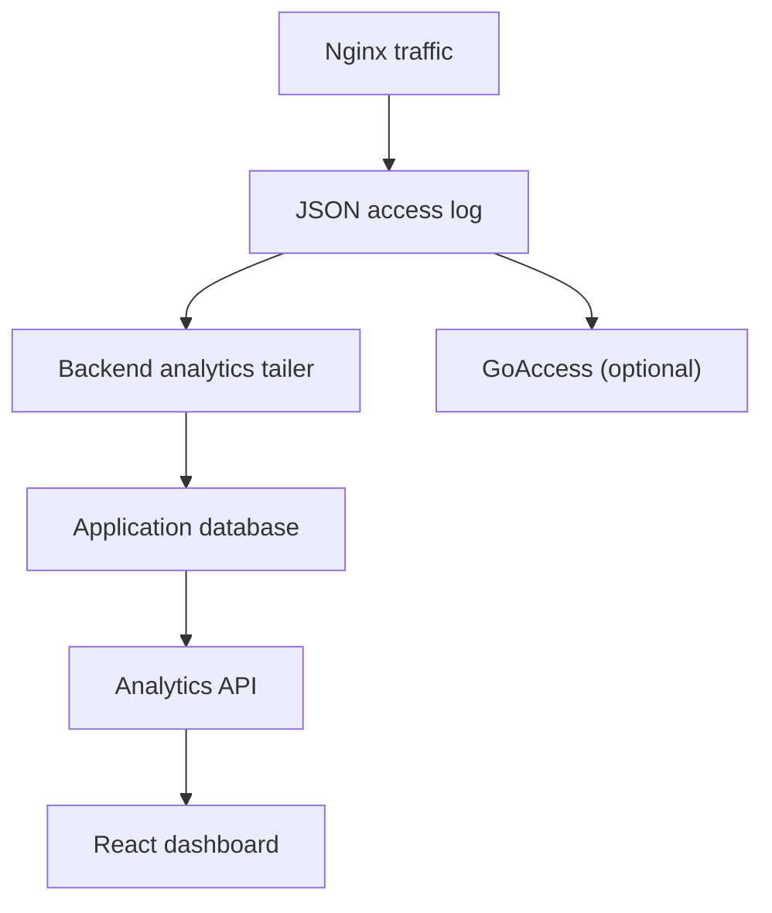

# Advanced Analytics

ShieldPM includes a built-in traffic dashboard. The backend parses local Nginx JSON access logs and stores request details and aggregates in the configured application database. Request details include client IPs, paths and user agents; treat that database and its backups as sensitive.

---

## 🏗️ Architecture



---

## Key Features

- **Traffic Overview:** displays recently ingested request counts and the live network throughput of the server. Aggregates flush approximately every 10 seconds.
- **Requests Over Time:** Area chart showing traffic trends over the last 1h, 24h, 7d, or 30d.
- **Status Codes:** Bar chart breakdown of HTTP response codes (2xx, 3xx, 4xx, 5xx).
- **Top Lists:**
  - **Countries:** GeoIP-based breakdown of traffic sources.
  - **IPs:** Most frequent client IP addresses.
  - **Referrers:** Top domains linking to your services.
  - **Paths:** Most requested URL paths.
  - **User Agents:** Breakdown of browsers and devices.
- **Recent Requests:** Detailed table of the latest requests with method, status, path, IP, and duration.
- **Database Statistics:** engine-dependent metrics including:
  - **Database Size:** Current size of the application database.
  - **Engine Type:** Shows SQLite, MySQL, or PostgreSQL.
  - **Connections:** Number of active database connections.
  - **Read/Write I/O:** Cumulative read and write operations:
    - **SQLite:** Attempts `PRAGMA cache_stats`; when unavailable, I/O counters remain zero.
    - **MySQL:** Uses `Handler_read_rnd_next` and `Handler_write` status variables.
    - **PostgreSQL:** Uses `blks_read`, `blks_hit`, and tuple statistics from `pg_stat_database`.

## Live Traffic Flow (experimental)

Enable `TRAFFIC_FLOW_ENABLED=true` in the backend environment, restart ShieldPM,
and save the relevant Proxy Hosts to regenerate their Nginx configuration. Open
**Analytics → Live Traffic Flow**. The preview preserves the existing Analytics
page and requires both Analytics access and Proxy Host visibility. The server
rechecks permissions on every snapshot.

The four columns show client network prefixes → schematic Internet → individual
Proxy Hosts → upstream targets. Multiple domains remain one host. Expand client
groups, search hosts, switch to the accessible list, or pause updates. The
Internet node is a visual connector, not a discovered network hop. The two
segments around it must not be summed as separate traffic.

For current HTTP/1, HTTP/2 stream, WebSocket and HTTP/3 rates, also set `TRAFFIC_FLOW_LIVE_ENABLED=true` and use the
matching native-module build from **shieldpm-nginx**. Restart and save hosts to
regenerate configuration. The static `shieldpm_traffic_flow` directive must be
available; Nginx validation rejects configurations on older binaries. Without
fresh supported native samples, the view explicitly falls back to completed
requests and unknown rates, with five-second refreshes.

The native module samples cumulative counters during active transfers, initially,
approximately every second, and at completion. Rates use actual monotonic elapsed
time between samples. For HTTP/1 they measure **HTTP bytes accepted by Nginx transport**,
including headers; HTTPS counters describe plaintext accepted by TLS. They do not
measure wire packets, TCP acknowledgements, or confirmed delivery. Both client
upload/download and individual upstream-attempt upload/download are measured for
HTTP/1 proxy traffic, HTTP/2 streams and WebSocket upgrades. HTTP/2 sent bytes
include per-stream frame headers; received bytes use request accounting and do
not distribute connection-wide frames. WebSocket counters include the handshake
and actual frame transport bytes. HTTP/3 download rates measure unique QUIC
stream bytes acknowledged by the peer; upload rates measure consumed decrypted
stream bytes, including HTTP/3 framing. Queued output and retransmitted copies
are not additional acknowledged bytes. This is neither wire throughput nor the
same accounting as HTTP/1 accepted writes. The stream observer survives request
cleanup until stream closure; final samples without complete acknowledgement
coverage remain unknown. Other upstream protocols remain unknown. No system
totals or completion logs are substituted.

Supported fresh sources refresh approximately every second. A missing baseline,
counter reset, unsupported protocol, or gap exceeding 3.5 seconds gives unknown,
not zero. Group totals are unknown when any included observation is unknown or when byte
accounting methods differ. Tooltips identify each direction’s measurement method;
accepted transport bytes are not summed with acknowledged stream bytes. Expand
**Measured groups by byte accounting** within a mixed client prefix to inspect
compatible components with their own exact rates, windows and shared scale.
Component identities describe accounting methods, never people or devices.
Exact tooltips show directional rates, sample windows and the number of samples;
group window bounds enclose the individual request intervals. Displayed line
widths use a 0.35 exponential moving average and one fixed logarithmic scale:
`min(16, 2 + log2(1 + bytes_per_second / 1024))` pixels. Exact values are unsmoothed.
The two schematic Internet segments repeat the same client aggregate.

- Solid lines identify recently observed paths. Upstream
  addresses are concrete recorded TCP peers/attempts, not proof of a successful
  response. Retries do not create extra client requests. Client groups and
  upstream observations are summarized separately per host; they do not claim
  a one-to-one client-to-upstream connection map.
- Dashed lines identify configured direct, pool, or location targets. DNS names
  do not assert which address was used. Advanced configuration can add unknown
  paths; Anubis observation and TCP/UDP Streams are not supported.
- Dotted lines and unknown rates indicate missing evidence, not zero traffic.
  Cache hits do not create upstream observations. Counts and response body bytes
  are completed-request samples, not wire bytes, upload bytes, or current rates.

Collection uses best-effort loopback UDP on port 15149 with an 8 KiB datagram cap
and a 2,000 datagram/second processing budget. At most 1,000 completion records and 1,000 native request records
are retained for a 60-second visible window. Snapshots contain at most 100 hosts,
32 client groups and 32 observed peers per host. The sample is always marked
incomplete: native tracking is capped at 256 requests per worker and 16 upstream
attempts per request; UDP loss and bounded retention make exact totals impossible. Collector
errors and stale snapshots are shown explicitly; an idle collector cannot prove
that there was no traffic. Other local processes can send to the UDP port, so this
view is operational telemetry, not security evidence.

Only IPv4 /24 and IPv6 /48 prefixes are retained in the flow buffer. A prefix is
not a person or device. The dedicated telemetry contains no URL, cookie, header,
or body content and creates no new disk log or database writes. Existing Analytics
logging and retention remain separate. Client addresses use Nginx `$remote_addr`;
correct attribution behind another proxy depends on the existing trusted Real-IP
configuration.

To roll back, unset `TRAFFIC_FLOW_ENABLED` (or set it to `false`), restart, and
save the previously enabled Proxy Hosts to remove telemetry directives. Disable
`TRAFFIC_FLOW_LIVE_ENABLED` before returning to a binary without the native module.
The backend stops collecting immediately after restart; until configuration is
regenerated, Nginx may still send completion datagrams to the unused local port.
No migration or data rollback is required.

Measurement evidence can be reproduced with an installed ShieldPM Nginx binary:

```bash
TRAFFIC_SMOKE_NGINX_BIN=/path/to/nginx \
TRAFFIC_SMOKE_LUA_DIRECTORY=/path/to/lua/5.1 \
node scripts/benchmarks/traffic-flow-measurement.mjs
```

The isolated loopback test holds a 128 KiB response open, checks that no log or UDP
observation exists while data is already arriving, then verifies the exact final
body-byte count, concrete upstream, masked prefix, and unknown rate through the
actual template and collector parser. The actual native source and application collector can be checked together:

```bash
TRAFFIC_SMOKE_NGINX_BIN=/path/to/native-module/nginx \
node scripts/benchmarks/traffic-flow-native-measurement.mjs
```

This test verifies active client and upstream download/upload rates before
completion, exact cumulative-counter differences and masked prefixes. The native
repository additionally validates keepalive resets, retries, abort cleanup,
HTTPS, reload generations, and HTTP/2 multiplexed cross-host isolation and open WebSocket bidirectional frames.
HTTP/3 is additionally validated with simultaneous cross-host streams, a held
upload, packet loss and delayed acknowledgements, reset/disconnect cleanup, and
stream churn. To verify a real native capture through the application collector:

```bash
node scripts/benchmarks/traffic-flow-native-capture.mjs /path/to/native-samples.json
```

The final production-image capture contained 555 requests; the app independently
verified 869 exact counter intervals, including 52 active download and 14 active
upload intervals. The production binary passed the module gate, 694 runtime
samples, 28 HTTP/2/WebSocket protocol samples and seven HTTP/3 cases covering
packet loss, delayed acknowledgements, resets, disconnects, capacity and reloads. These counts describe the test run, not production traffic totals.

## Privacy

The built-in analytics service does not need a third-party analytics provider. It stores IP addresses and other request details locally. By default, detailed database rows are deleted after 24 hours and minute aggregates after 35 days; the retention job runs on startup and hourly. Set `ANALYTICS_DETAILED_RETENTION_HOURS` and `ANALYTICS_AGGREGATION_RETENTION_DAYS` to change those periods. Nginx log-file rotation is a separate mechanism. GoAccess can be configured independently with its own `GOACLA` options, including IP anonymization.

## Configuration

Built-in analytics are enabled by default. GoAccess is **off** by default (`GOA=false`); enable it with `GOA=true` to use its separate dashboard on `GOA_PORT` (default `91`). Per-host analytics is limited to hosts the user can view according to server-side permission checks; global analytics requires the `analytics:list` permission.

### Enabling GeoIP (Country Statistics)

ShieldPM prepares `GeoLite2-Country.mmdb`, `GeoLite2-City.mmdb`, and `GeoLite2-ASN.mmdb` in `/data/nginx` automatically before services start. The default `GEOIP_AUTO_UPDATE=true` checks the [latest GeoLite.mmdb release](https://github.com/shedowe19/GeoLite.mmdb/releases/latest) on the first start and every later start. This needs no MaxMind account, license key, or separate updater container.

If a shared public IP reaches GitHub's anonymous API rate limit, an optional `GEOIP_GITHUB_TOKEN` authenticates only the exact latest-release metadata request. It is never forwarded to redirects or database assets. Leave it unset for the default public download; keep any configured token private.

Files already matching the release's size, SHA-256 digest, and database validation are reused. New files are staged and all three databases verified before replacement: the native MMDB reader must open each file with the expected database type and format. If downloading or verification fails, a complete valid previous cache permits startup with a warning; without that cache, startup stops before services run. Unsafe destination paths, another running updater, or incomplete recovery also stop startup. Automatic updates run during startup.

Downloading the files is independent of module activation. To use country statistics and the firewall's country/ASN lookups, enable the GeoIP2 module.

#### 1. Enable the Nginx module

```yaml
# Docker (compose.yaml)
environment:
  - "GEOIP_AUTO_UPDATE=true" # default; prepares all three databases at startup
  - "NGINX_LOAD_GEOIP2_MODULE=true"
```

```bash
# Native / LXC (/data/.env)
GEOIP_AUTO_UPDATE=true
NGINX_LOAD_GEOIP2_MODULE=true
```

#### 2. Restart ShieldPM

```bash
# Docker
docker compose up -d

# Native / LXC
systemctl restart shieldpm
```

Once started, Nginx uses the prepared databases and new requests can include country and ASN information. With `GOA=true`, GoAccess also discovers City, Country, and ASN files in `/data/nginx` at startup. For each database, an existing non-empty file in `/data/goaccess/geoip` takes precedence. An explicit `--geoip-database` setting in `GOACLA` disables this automatic discovery.

### Offline or custom GeoIP data

Set **`GEOIP_AUTO_UPDATE=false`** in the ShieldPM environment to disable the automatic GitHub release check and downloads. Use this for offline installations or databases maintained through your own MaxMind updater. Provide the files required by active Nginx GeoIP blocks in `/data/nginx`; module activation remains a separate setting.

**Docker with a custom MaxMind updater:** Keep `GEOIP_AUTO_UPDATE=false` on the ShieldPM service and configure the optional sidecar with your own [MaxMind account](https://www.maxmind.com/en/geolite2/signup):

```yaml
geoipupdate:
  container_name: shieldpm-geoipupdate
  image: ghcr.io/maxmind/geoipupdate:latest
  restart: always
  network_mode: bridge
  environment:
    - "TZ=Europe/Berlin"
    - "GEOIPUPDATE_EDITION_IDS=GeoLite2-Country GeoLite2-City GeoLite2-ASN"
    - "GEOIPUPDATE_ACCOUNT_ID=<your-account-id>"
    - "GEOIPUPDATE_LICENSE_KEY=<your-license-key>"
    - "GEOIPUPDATE_FREQUENCY=24"
  volumes:
    - "/opt/shieldpm/nginx:/usr/share/GeoIP"
```

> [!IMPORTANT]
> The volume path must be `/opt/shieldpm/nginx` on the host side, as this maps to `/data/nginx` inside the ShieldPM container, which is where Nginx expects the files.

**Native / LXC with a custom MaxMind updater:** Set `GEOIP_AUTO_UPDATE=false` in `/data/.env`, then configure your own updater:

```bash
apt install -y geoipupdate
cat > /etc/GeoIP.conf << EOF
AccountID <your-account-id>
LicenseKey <your-license-key>
EditionIDs GeoLite2-Country GeoLite2-City GeoLite2-ASN
DatabaseDirectory /data/nginx
EOF
chmod 600 /etc/GeoIP.conf
geoipupdate
# Setup weekly cron
echo "0 3 * * 3 root /usr/bin/geoipupdate > /dev/null 2>&1" > /etc/cron.d/geoipupdate
```

Enable `NGINX_LOAD_GEOIP2_MODULE=true` and restart ShieldPM after first providing the custom databases. Existing independently configured updater services or cron jobs remain your responsibility; automatic startup downloads are disabled by the opt-out.

### ASN data for the IP Firewall

The [IP Firewall](./IP-Firewall.md#block-autonomous-systems-for-a-host) uses the same automatically prepared `GeoLite2-ASN.mmdb` to show the visitor network and apply per-host ASN rules. Keep `NGINX_LOAD_GEOIP2_MODULE=true`. For a custom updater, include `GeoLite2-ASN` in its editions. The firewall startup configuration uses `/data/nginx/GeoLite2-ASN.mmdb`; a file available only to GoAccess under `/data/goaccess/geoip` does not configure this Nginx lookup.

Keep the Country/City databases referenced by existing active Analytics blocks available. Their configuration and the existing GoAccess discovery remain unchanged. ASN data does not provide country codes, and this integration adds no ASN chart to the Analytics dashboard.

## Related pages

- [IP Firewall](./IP-Firewall.md)
- [Configuration](./Configuration.md)
- [Docker Compose reference](./Docker-Compose-Reference.md)
